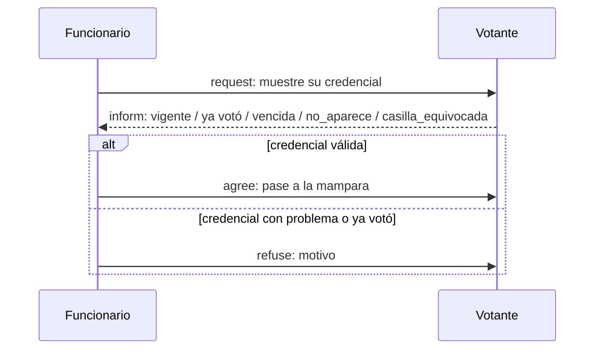
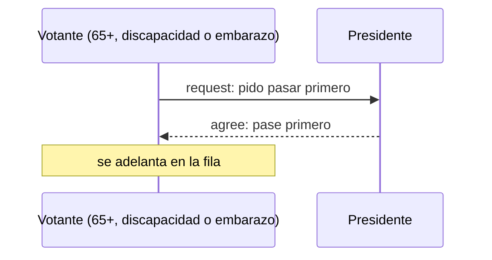
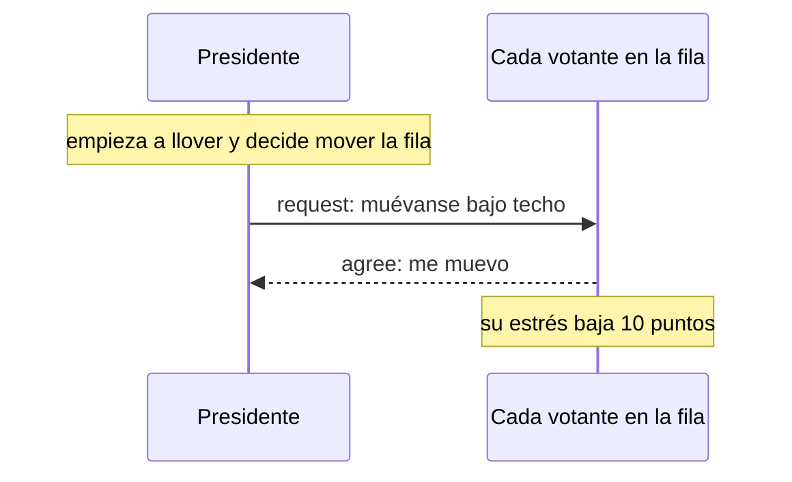
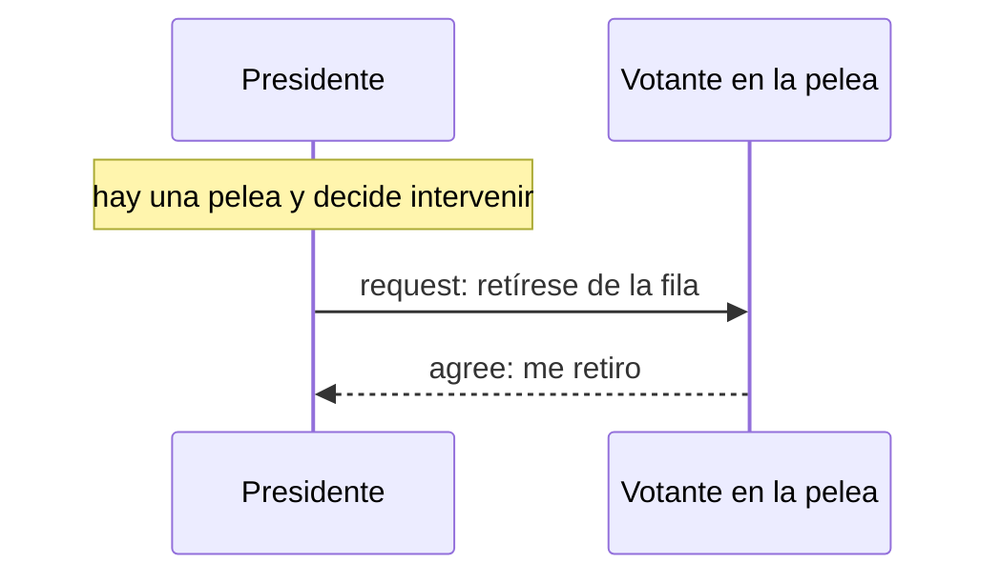
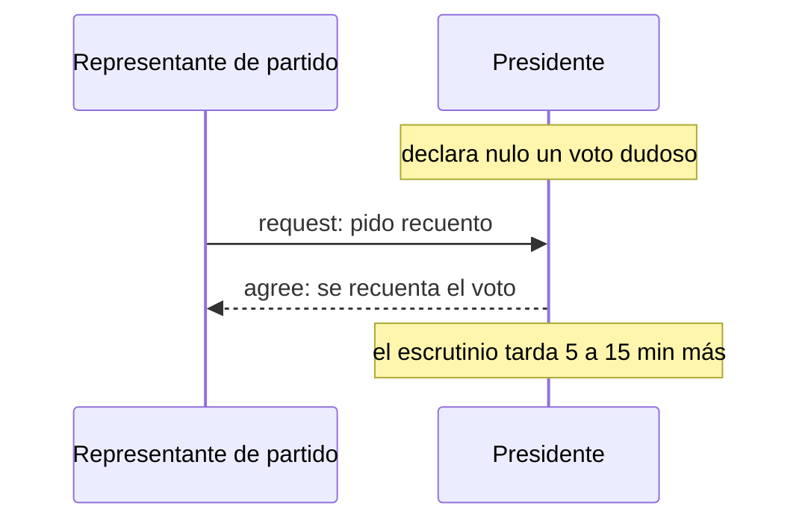
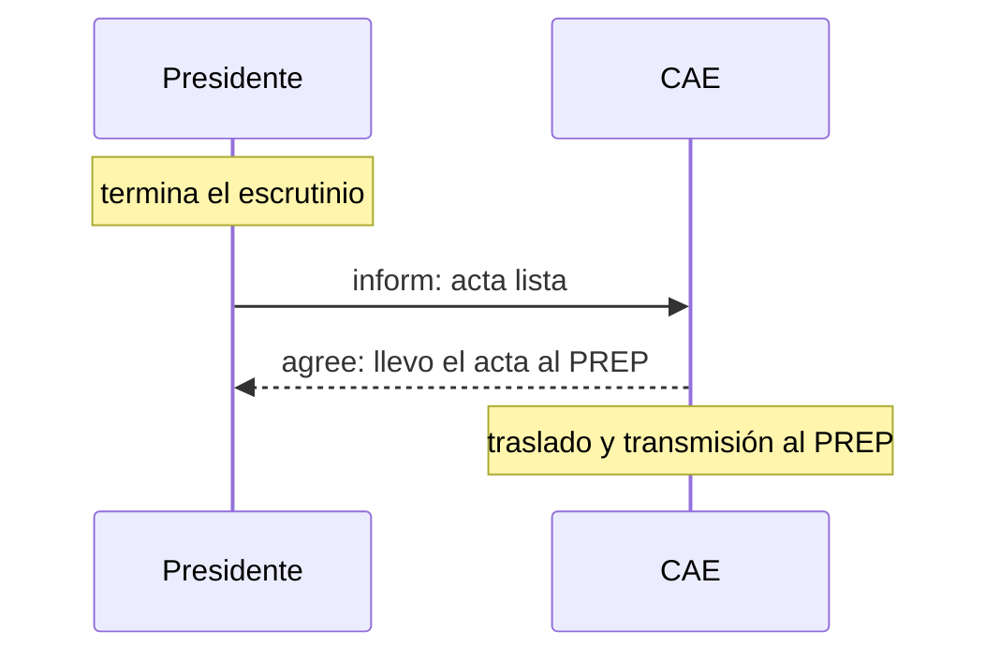

# Protocolos de comunicación entre agentes

Los agentes se comunican con mensajes al estilo FIPA: `modelo.enviar(t, emisor, receptor, performativa, contenido)`.
El receptor decide su respuesta en su método `recibir`. Todos los mensajes se guardan en `mensajes_agentes.csv`.

| Performativa | Significado |
|---|---|
| `request` | El emisor pide algo |
| `inform` | El emisor comunica un dato |
| `agree` | El receptor acepta |
| `refuse` | El receptor se niega o rechaza |

## 1. Verificación de credencial (Funcionario ↔ Votante)

## 2. Prioridad en la fila (Votante → Presidente)

## 3. Mover la fila bajo techo (Presidente → Votantes en fila)

## 4. Retirar a un revoltoso (Presidente → Votante)

## 5. Protesta de un voto nulo (Representante → Presidente)

## 6. Entrega del acta (Presidente → CAE)

